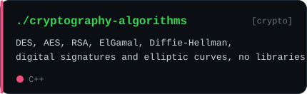
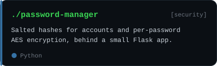
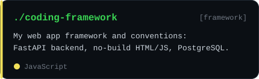
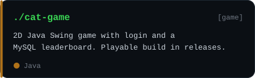

<p align="center">
  
</p>

```text
> whoami
  CS graduate (2026). Started in cybersecurity, now I build things.
  Boring backends in production, fun algorithms on paper.

> now
  building my own apps and shipping them myself

> log
  [2026] ICPC Amman Collegiate Programming Contest
  [2026] ICPC Jordanian Collegiate Programming Contest
  [2025] ICPC Jordanian Collegiate Programming Contest
  [----] CS50x and CS50AI (Harvard, online)
```

### `> ls ~/tools`

<p>
  
</p>

### `> ls ~/projects --public`

<p>
  <a href="https://github.com/IbrahimZubaidi/cryptography-algorithms"></a>
  <a href="https://github.com/IbrahimZubaidi/password-manager"></a>
  <a href="https://github.com/IbrahimZubaidi/coding-framework"></a>
  <a href="https://github.com/IbrahimZubaidi/cat-game"></a>
</p>

<sub>Most of my client and company work is private, so it does not show here.</sub>

### `> trace --contributions`

<picture>
  <source media="(prefers-color-scheme: dark)" srcset="https://raw.githubusercontent.com/IbrahimZubaidi/IbrahimZubaidi/output/snake-dark.svg">
  
</picture>

<sub>`exit 0`</sub>
